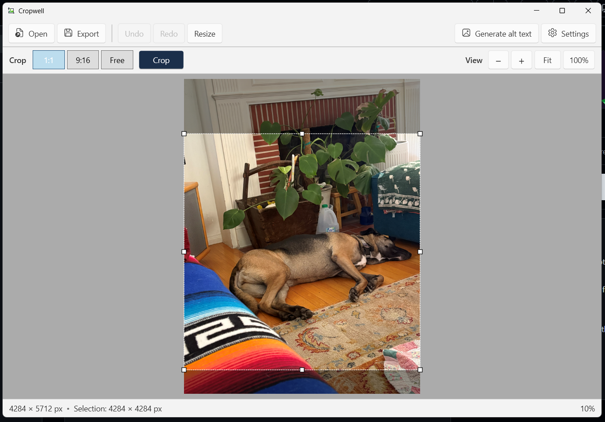
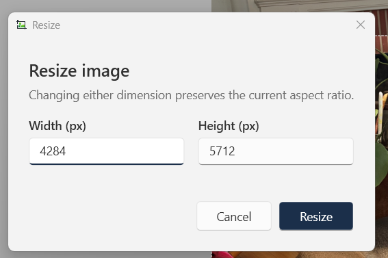
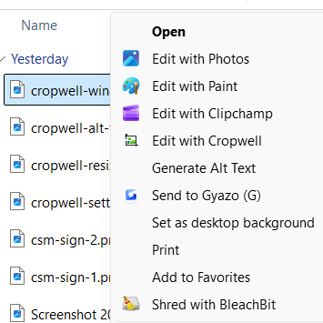
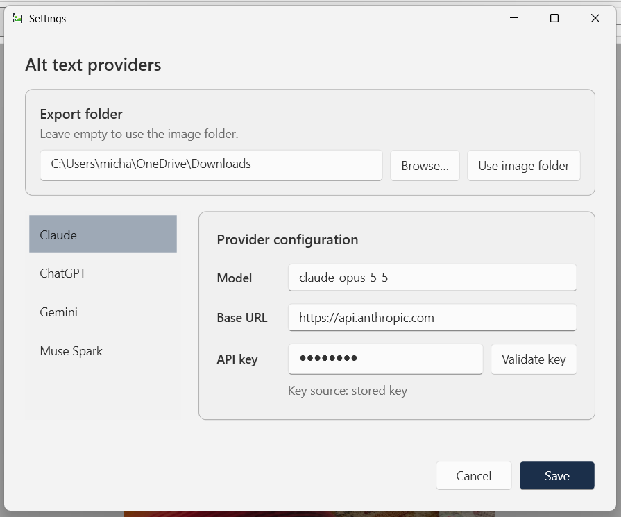
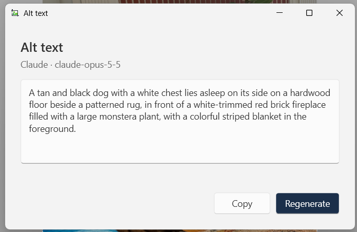

# Cropwell

Cropwell is a Windows 11 desktop app for preparing one image at a time for social media. It opens common image formats or captures a selected area of the screen, normalizes orientation and color, provides fixed and free crop tools, resizes with Lanczos resampling, exports without source metadata, and generates accessible alt text with a selected LLM.

<p align="center"></p>

<p align="center"></p>

Cropwell is a C# WPF application targeting .NET 10 and `win-x64`.

## Download

Download `Cropwell.exe` from the latest release on the [Releases page](https://github.com/cruftbox/cropwell/releases). It is a single file that runs without installing anything else. Put it in any folder and double-click it.

### First launch

Cropwell is not code-signed, so Windows SmartScreen blocks the first launch with a "Windows protected your PC" message. To run it:

1. Choose **More info**.
2. Confirm that the app name is `Cropwell.exe`.
3. Choose **Run anyway**.

Windows remembers this choice for that file, so later launches open normally. Each new release is a new file and shows the message once again.

Your browser may also warn that the file is not commonly downloaded. In Microsoft Edge, choose **Keep**, and then **Keep anyway** if asked.

If Smart App Control is turned on, Windows blocks unsigned apps without offering **Run anyway**, and Cropwell cannot run.

### Right-click menu

`add_context_menu.reg` adds **Edit with Cropwell** to the right-click menu for image files in File Explorer. It applies to the current user only.

<p align="center"></p>

1. Open `add_context_menu.reg` in a text editor.
2. Replace every `C:\\Code\\cropwell\\artifacts\\publish\\Cropwell.exe` with the full path to your copy of `Cropwell.exe`. Keep the doubled backslashes, for example `C:\\Tools\\Cropwell.exe`.
3. Save the file and double-click it to import it.

If you move `Cropwell.exe` later, repeat these steps with the new path.

On Windows 11 the entry appears under **Show more options**. To make the classic menu the default for every file, double-click `classic_context_menu.reg`, then restart Explorer or sign out. This uses a registry setting that Microsoft does not document, so a Windows update could stop it working. To undo it, run:

```powershell
reg delete "HKCU\Software\Classes\CLSID\{86ca1aa0-34aa-4e8b-a509-50c905bae2a2}" /f
```

## Build

Install the .NET 10.0.402 SDK, then run this command from the repository root:

```powershell
.\build.ps1
```

The self-contained single-file executable is written to `artifacts\publish\Cropwell.exe`. The app has no application-level third-party NuGet package dependencies; publish restores Microsoft's target runtime pack when necessary.

Run the offline checks with:

```powershell
.\test.ps1
```

GitHub Actions runs the tests and the build on every push to `main` and on pull requests. Each run stores `Cropwell.exe` as a workflow artifact. Pushing a tag that starts with `v`, such as `v0.1.0`, also creates a release with `Cropwell.exe` attached.

## API keys and providers

Open Settings with the toolbar button or `Ctrl+,`. Select a provider, enter its API key, and choose Save. Cropwell stores a separate key for each provider as a generic credential in Windows Credential Manager. Keys are not written to `settings.json` or the log.

<p align="center"></p>

Use **Validate key** to send a generated 1×1 image through the selected provider's configured model and base URL. This tests the pending key before it is saved and may incur a small provider charge.

The active provider is the one selected when Settings is saved. Each provider also has its own editable model and base URL. A stored key takes precedence over the corresponding environment variable.

Settings also includes an optional export folder. When it is empty, Cropwell uses the last export folder from the current session or the source image's folder. When it contains an existing folder, that folder is the default location for every export.

| Provider | Default model | Base URL | Environment variable |
|---|---|---|---|
| Claude | `claude-opus-5-5` | `https://api.anthropic.com` | `ANTHROPIC_API_KEY` |
| ChatGPT | `gpt-6-sol` | `https://api.openai.com` | `OPENAI_API_KEY` |
| Gemini | `gemini-3.8-flash` | `https://generativelanguage.googleapis.com` | `GEMINI_API_KEY` |
| Muse Spark | `muse-spark-1.3` | `https://api.meta.ai/v1` | `META_API_KEY` |

Set `CROPWELL_MOCK=1` before launch to add a Mock provider that returns a fixed sentence without making a network request.

<p align="center"></p>

## Provider verification

Provider APIs and model IDs change. Before a release, check each default model against the vendor's current documentation, then verify each provider locally:

1. Save a valid local key for the provider in Settings, select that provider, and save.
2. Open a small image with recognizable content.
3. Generate alt text and confirm that one non-empty sentence appears with the expected provider and model label.
4. Crop or resize the image, regenerate, and confirm that the request describes the changed working image.
5. Cancel a request and confirm that no late result replaces the current text.
6. Remove or invalidate the key and confirm that the error appears in the alt-text window without exposing request details.

Repeat the procedure for Claude, ChatGPT, Gemini, and Muse Spark. Muse Spark must specifically be checked with an image because its OpenAI-compatible endpoint must accept `input_image` parts.

## Images and codecs

Cropwell uses Windows Imaging Component. JPG, PNG, GIF, TIFF, and BMP support comes from Windows. WebP and HEIC depend on codecs installed in Windows. These system codecs are not bundled with Cropwell. A missing or decode-only codec produces a normal open or export error.

## Local data

Non-secret settings are stored in `%APPDATA%\Cropwell\settings.json`. Logs are stored in `%LOCALAPPDATA%\Cropwell\logs\cropwell.log` and rotate at 1 MB with three backups. Logs contain file names, provider/model names, HTTP statuses, and error details. They do not contain API keys, request headers, image data, or generated text.

## License

Cropwell is licensed under the MIT License. See [LICENSE](LICENSE) and [THIRD_PARTY_NOTICES](THIRD_PARTY_NOTICES).
